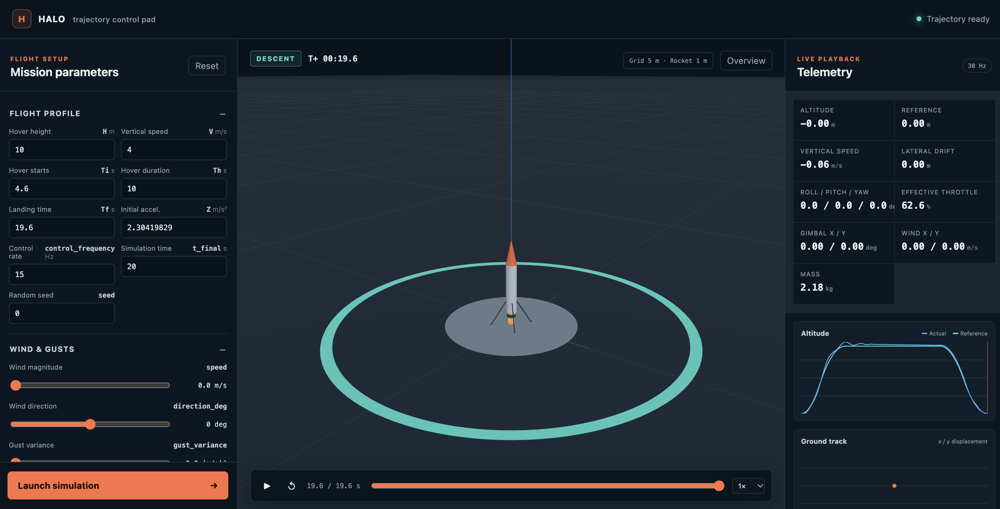

# Halo Avionics-Control Simulations

Code for simulating the trajectories of Halo and Halo Jr. under different control algorithms.

## Dashboard

From the repository root, run:

```bash
python dashboard.py
```

Open the local address printed in the terminal to configure a flight and view its 3D animation, trajectory, and telemetry.



Visual inspired by https://github.com/aryamehr2k/rocket-landing-rl-simulator.

## RocketSim.py

RocketSim.py defines the rocket’s flight physics and the Controls class. The physics model evolves position, velocity, orientation, angular velocity, and mass while accounting for thrust, aerodynamics, gravity, wind, and gusts.

Controls implements LQR guidance for thrust and gimbal commands, a Kalman filter for state estimation, and roll control for a cold-gas thruster based reaction control system. Simulation runs cache their timestamps, states, and control commands for plotting and playback.

## RocketSimTest2.ipynb

Use this notebook to set rocket and controller parameters, run individual flights, and plot their trajectories and control commands. It also contains examples of optimizing LQR weights and trajectory parameters against flight performance objectives.

## RocketSim3DLQRKalmanAero.ipynb

This notebook derives the three-dimensional rocket dynamics used by the simulator, including aerodynamic effects. A markdown cell includes LaTeX equations of the derivation.